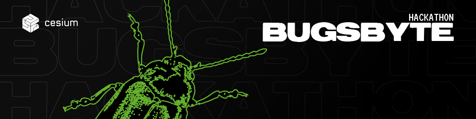

[contributing]: CONTRIBUTING.md
[code_of_conduct]: CODE_OF_CONDUCT.md
[license]: LICENSE

[ci-test-status]: https://github.com/cesium/ares/actions/workflows/test.yml/badge.svg
[ci-test-workflow]: https://github.com/cesium/ares/actions/workflows/test.yml
[ci-style-status]: https://github.com/cesium/ares/actions/workflows/style.yml/badge.svg
[ci-style-workflow]: https://github.com/cesium/ares/actions/workflows/style.yml

# Ares

[![CI Test][ci-test-status]][ci-test-workflow]
[![CI Style][ci-style-status]][ci-style-workflow]

Ares is the platform for [BugsByte](https://bugsbyte.org/), CeSIUM's 48-hour hackathon. Built with [Elixir](https://elixir-lang.org/) and [Phoenix Framework](https://www.phoenixframework.org/), it is the place where participants get to know the event, its sponsors and partners, and sign up to compete.

It is also responsible for team formation, ticket payments through [Midas](https://github.com/cesium/midas), and an admin backoffice to manage the participating companies and the event settings.

## 🤝 Contributing

When contributing to this repository, please first discuss the change you wish
to make via discussions, issue, email, or any other method with the owners of
this repository before making a change.

Please note we have a [Code of Conduct][code_of_conduct], please follow it
in all your interactions with the project.

We have a [Contributing Guide][contributing] to help you getting started.

## 📝 License

Copyright (c) 2026, CeSIUM.

This project is licensed under the MIT License - see the [LICENSE][license]
file for details.
